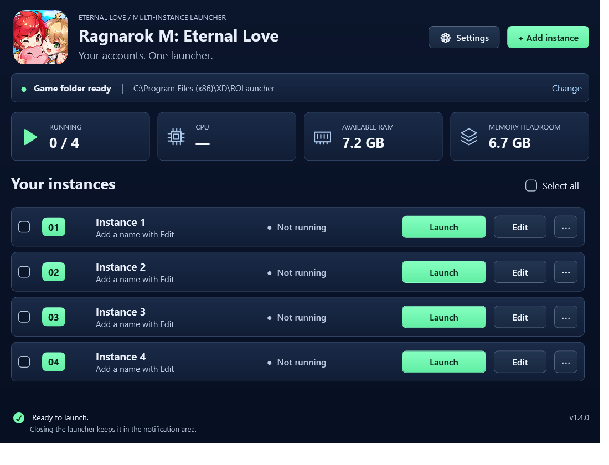
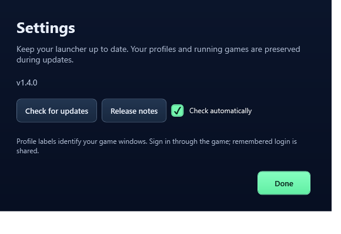

<div align="center">

# RO Eternal Love Launcher

### Your accounts. One launcher.

Launch and manage **Ragnarok M: Eternal Love** game windows from one compact Windows app.

[](https://github.com/yajra/rom-multi-client/releases/latest)
[](https://github.com/yajra/rom-multi-client/actions/workflows/windows-release.yml)


**[Download for Windows](https://github.com/yajra/rom-multi-client/releases/latest)**
&nbsp; · &nbsp; [Quick start](#get-started)
&nbsp; · &nbsp; [What's new](CHANGELOG.md)
&nbsp; · &nbsp; [Report an issue](https://github.com/yajra/rom-multi-client/issues)



<sub>Implemented launcher design based on the approved mockup. Profiles and resource readings vary by PC.</sub>

</div>

## More game windows, less juggling

Keep up to **12 instance profiles** in one place, with names and notes that make each window easy to recognize. All instances share one installed copy of the game's data.

| | What you can do |
| --- | --- |
| **Launch together** | Select a few instances or select all, then launch them in order. Games already running are skipped. |
| **Find the right window** | Give each instance a name and bring its game window forward with **Show game**. |
| **Watch your resources** | See running instances, CPU usage, available RAM, and memory headroom at a glance. |
| **Keep profiles organized** | Add account labels and character notes; remove profiles without deleting game files. |
| **Stay up to date** | Check for releases in **Settings**, then update and restart while your games stay open. |
| **Keep it out of the way** | Close the launcher window to keep it in the Windows notification area. |

## Get started

1. **Download the EXE** from the [latest release](https://github.com/yajra/rom-multi-client/releases/latest). Choose `RO-Eternal-Love-Launcher-VERSION-win-x64.exe` under **Assets**.
2. **Keep it in a permanent, writable folder** and double-click it. The release includes the .NET runtime; no installer or separate runtime download is needed.
3. **Choose your game folder.** Click **Change** beside the folder status and select the directory containing `ro_win.exe` and `ro_win_Data`.
4. **Name your instances and launch.** Use **Edit** for labels, **+ Add instance** for more profiles, and **Launch** to open a game window.

**You need:** Windows 10 or 11 x64, an existing Ragnarok M: Eternal Love installation, and write access to its game folder. Your hardware determines how many instances can run comfortably; the launcher warns when memory is low.

> **Using different accounts?** You need to sign in to the account you want inside each game window. See the [known limitation](#known-limitation-signing-in-to-different-accounts) below.

## Known limitation: signing in to different accounts

**By default, ROM remembers one account per Windows user: the last account you signed in to.** Instances launched under your normal Windows user share that remembered account.

### Remembering a separate login

New instances automatically use a separate remembered game login. Saving requests Windows administrator approval to create a standard local user matching the executable name (for example, `ro_win1` for Instance 2) and hide it from the Windows sign-in screen. Approve using your current Windows administrator account; setup under a different administrator identity is not supported. There is no checkbox to enable.

The launcher stores a generated Windows password in your Windows Credential Manager and loads that user's profile when launching the game. Sign into ROM on the first launch. Existing sessions can still expire. This is experimental until tested with the current ROM client; closing games owned by another user may need additional permissions.

Use **Edit → Game launch settings** to choose each instance's display, graphics, and FPS:

| Setting | Choices | Default |
| --- | --- | --- |
| Display | 540p windowed, 720p windowed, Fullscreen | 540p (960 × 540) |
| Graphics | Low, Medium, High | Low |
| FPS | Low (30), Medium (45), High (60) | Low (30) |

Fullscreen uses the game's desktop resolution. New and existing instances without saved choices use the lowest settings. Changes apply on the next launch; running games stay unchanged. Audio, controls, login data, and unrelated preferences are preserved. You can change settings in-game; the instance's saved launch choices are reapplied next time.

Google and other web sign-in requests are relayed to **your current Windows user's default browser**, while the game remains under its separate Windows account. Keep the launcher running. At the first separate-account launch in a launcher session, approve the administrator prompt using your current Windows account. The helper observes Windows web-opening requests only when their parent is a verified game process in your selected game folder, and exits with the launcher. It does not modify the game or save sign-in URLs to disk. Your browser's existing Google session is shared, so choose the intended Google account for each game instance. Browser routing does not guarantee that the game's authentication callback will accept the session.

The launcher requests focus for the sign-in browser and restores it if minimized. Windows may keep the browser in the background; the launcher does not join application input queues to force focus, because that can hang applications. If you switch to a different app while the browser is starting, it leaves that app focused.

If no browser opens, `%LOCALAPPDATA%\ROInstanceLaunchers\browser-relay-status.txt` reports relay readiness, successful browser launches, and whether Windows granted focus, without storing URLs or tokens.

Existing launcher profiles set up their separate login on the next normal launch after the game is closed. Windows may request administrator approval. Sign into ROM once in the new Windows profile. The launcher verifies that the loaded registry belongs to the instance user and checks a persistent storage marker on subsequent launches; it stops if that storage changes unexpectedly. Existing unrelated Windows users are never adopted. Removing a launcher profile preserves its Windows account and saved game data. Credentials are specific to the Windows account that set them up; copying `profiles.json` alone does not transfer them. Game files remain shared, but each Windows user has separate settings and caches.

For example, if you last signed in with Account A, a new game window may show Account A too—even if you named that launcher profile "Account B". To play as Account B, switch accounts and sign in to Account B inside that game window. Repeat this for each window where you want to use a different account.

Names and account labels in the launcher are just reminders to help you tell your windows apart. They do not log you in or switch accounts. The launcher does not save your game passwords.

## Everyday controls

| Control | What happens |
| --- | --- |
| **Launch** | Starts that instance and prepares its executable and shared-data link when needed. |
| **Show game** | Brings the running game window to the front. |
| **Edit** | Changes the profile name, account label, or server / character note. |
| **Select all → Launch selected** | Starts selected instances in number order, with a short pause between them. |
| **⋯ → Close game** | Requests a normal exit and brings the game forward for its confirmation prompt. |
| **⋯ → Remove profile** | Removes saved labels after confirmation. Game files and running games are kept. |
| **Settings** | Opens a modal for update checks, automatic-check preferences, and release notes. |

If a normal game exit does not finish, the launcher offers an optional force close. Unsaved progress may be lost if you choose it. A failed launch or declined memory warning stops the remaining launch queue.

Closing the launcher window hides it in the notification area. Double-click its tray icon to reopen it, or choose **Exit launcher (leave games running)** to exit completely.

<details>
<summary><strong>Preview the Settings dialog</strong></summary>



</details>

## Updates that keep your setup

Open **Settings → Check for updates**. When a newer stable version is available, choose **Update and restart**. Automatic checks run at startup and every six hours when enabled; installation always waits for your action.

- Downloads come from the public GitHub releases. No GitHub account or access token is required.
- The launcher verifies the download's SHA-256 checksum and expected version before installation.
- Profiles, shortcuts, and running game windows are preserved. This updates the launcher, not the game.
- The previous EXE is kept with a `.previous` suffix and restored if the new launcher fails its startup check.

You can also replace the launcher EXE manually after exiting it from the tray. Keep the same location to preserve shortcuts.

## Questions before downloading?

<details>
<summary><strong>Will the downloaded EXE work on its own?</strong></summary>

Yes. The release EXE is self-contained for Windows x64 and includes the .NET runtime. Download the EXE under **Assets**, not the source-code archive. You still need the Eternal Love game installed separately.

Builds created locally with `Build.ps1` are different: keep the entire `artifacts\app` directory together and install the .NET 8 Windows Desktop Runtime. See the [development guide](docs/DEVELOPMENT.md).

</details>

<details>
<summary><strong>Where are my profiles saved?</strong></summary>

Personal data stays in `%LOCALAPPDATA%\ROInstanceLaunchers`, outside the executable's folder and this repository.

| File / folder | Purpose |
| --- | --- |
| `profiles.json` | Game folder, profile names, and optional labels |
| `profiles.json.bak` | Previous successful profile save |
| `Updates\` | Update downloads and diagnostic reports |
| `ShortcutBackups\` | Backups created when migrating desktop shortcuts |

Labels are plain text. Do not enter passwords in them. Existing profiles from earlier versions are reused automatically.

</details>

<details>
<summary><strong>Does each instance duplicate all the game files?</strong></summary>

No. Additional instances use small executable copies and directory junctions to the original `ro_win_Data` folder. The launcher refreshes an instance's executable from the original when launching it after game updates, and leaves unrelated data directories unchanged.

The initial game-folder default is `C:\Program Files (x86)\XD\ROLauncher`. Use **Change** if yours is elsewhere.

</details>

<details>
<summary><strong>Why might Windows show a publisher warning?</strong></summary>

The executable is currently unsigned, so Windows may show a publisher or SmartScreen prompt. Releases include `SHA256SUMS.txt`; compare the EXE's hash with that file using PowerShell:

```powershell
Get-FileHash -LiteralPath '.\RO-Eternal-Love-Launcher-VERSION-win-x64.exe' -Algorithm SHA256
```

</details>

## Build or contribute

The launcher is a native **C# / WPF** app targeting **.NET 8**. The sign-in relay uses Microsoft's TraceEvent library for Windows process-start events.

See the [development guide](docs/DEVELOPMENT.md) for building, self-tests, desktop shortcuts, layout previews, and the release workflow. Use [GitHub issues](https://github.com/yajra/rom-multi-client/issues) for bugs and suggestions.

---

<div align="center">

Community launcher for Ragnarok M: Eternal Love.<br>
The game name and client artwork belong to their respective owners.

**[Get the latest release](https://github.com/yajra/rom-multi-client/releases/latest)**

</div>
